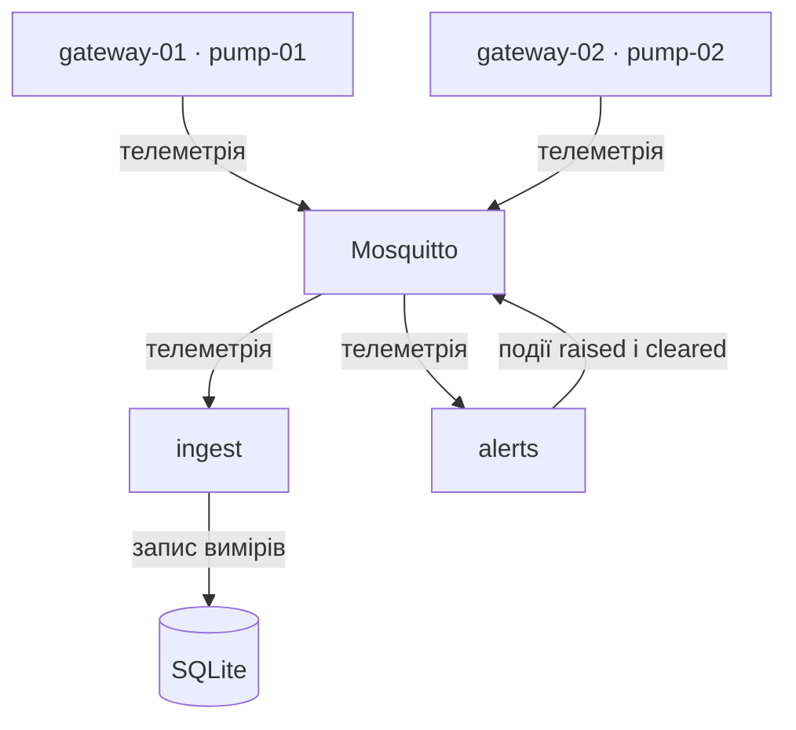

# Архітектура системи моніторингу насосів

Система контролює два змодельовані насоси на лінії `line1` майданчика `kyiv`.
Docker Compose запускає п’ять контейнерів. Кожен шлюз опитує свій насос
раз на секунду й публікує виміри через MQTT із QoS 1. Брокер Mosquitto
передає телеметрію двом незалежним споживачам.

## MQTT-топіки

| Топік | Призначення |
|---|---|
| `plant/kyiv/line1/<device_id>/telemetry` | Шлюз публікує виміри. Сервіси `ingest` і `alerts` їх отримують. |
| `plant/kyiv/line1/<device_id>/status` | Шлюз публікує `online`. При неочікуваному розриві зв’язку брокер публікує `offline` через Last Will. Останній статус зберігається в брокері як retained-повідомлення. |
| `plant/kyiv/line1/<device_id>/alerts` | Сервіс `alerts` публікує подію під час спрацювання або зняття правила. |

`<device_id>` набуває значення `pump-01` або `pump-02`.

## Формат повідомлень

Телеметрія містить `device_id`, час виміру `ts` і словник `metrics` із чотирма
показниками: `pressure_bar`, `temperature_c`, `vibration_mm_s`, `current_a`.
За наявності `SIGNING_KEY` шлюз передає телеметрію в підписаній оболонці
з полями `payload`, `ts`, `nonce`, `sig`. Обидва споживачі перевіряють підпис
для MQTT-топіка, з якого отримали повідомлення.

Сервіс `ingest` записує кожну метрику окремим рядком у таблицю `telemetry`.
Файл SQLite розміщено в томі `db-data`. Подія сповіщення містить `rule`,
`device_id`, `metric`, `state`, `value`, `ts` і `severity`. Значення `raised`
означає спрацювання правила, а `cleared` — його зняття.

## Результат перевірки

Усі п’ять контейнерів отримали статус `Healthy`. На момент контрольного
SQL-запиту база містила 772 записи для `pump-01` і 776 для `pump-02`.
Після ввімкнення несправності підшипника сервіс зафіксував `high_vibration raised`.
Перезапуск симулятора повернув вібрацію до норми, і з’явилося `cleared`.
Після повторного ввімкнення несправності правило знову перейшло в `raised`.